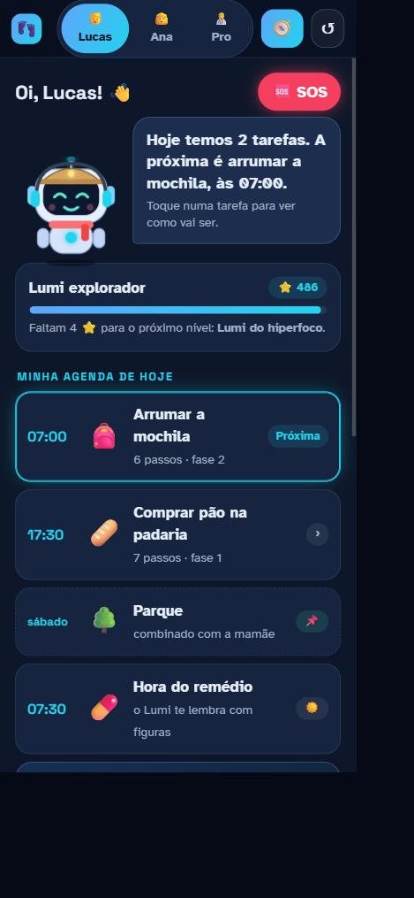
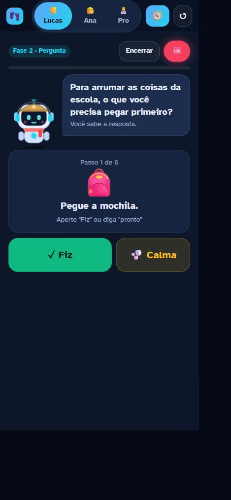
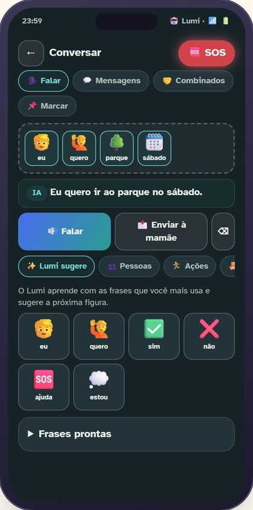
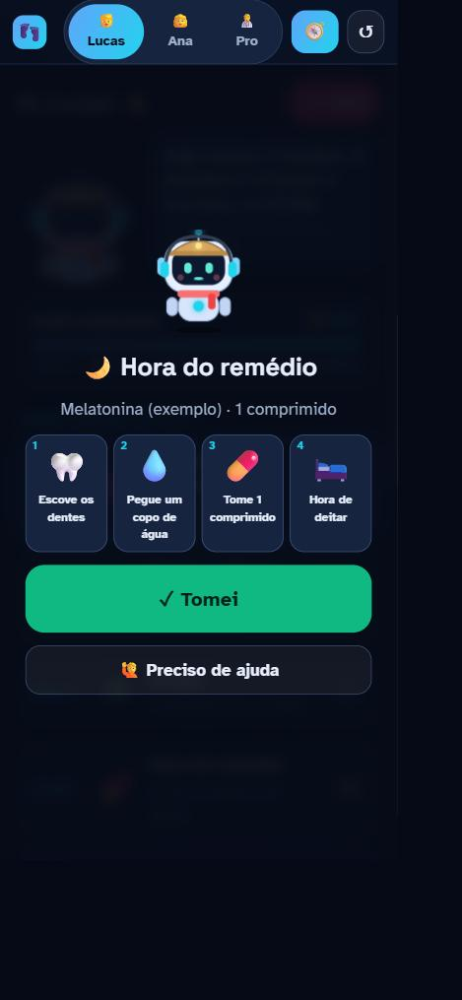
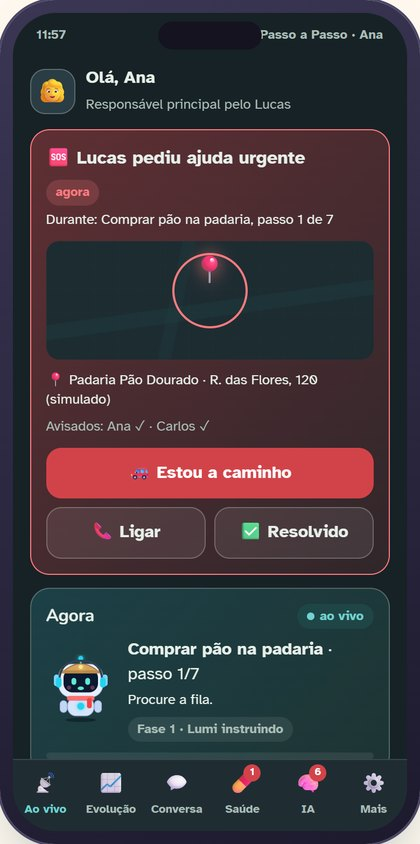
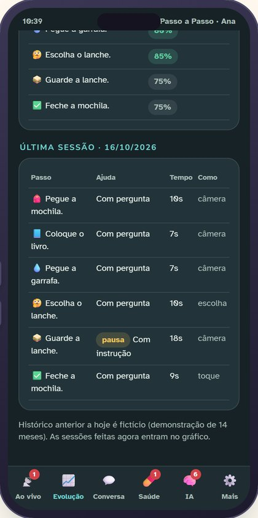
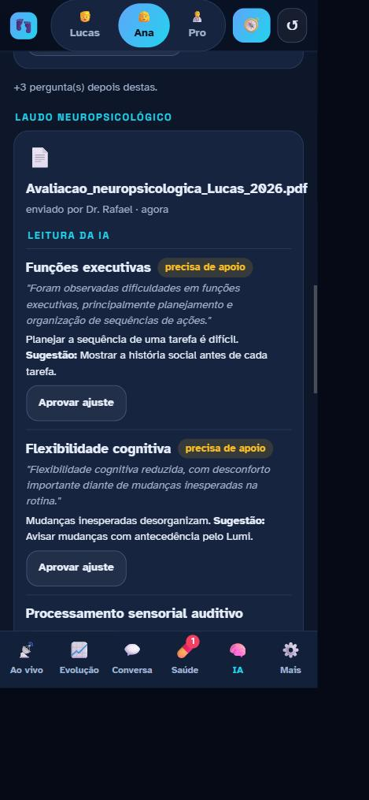
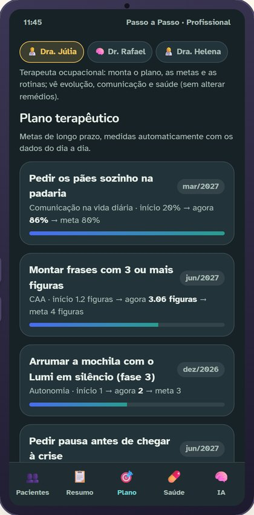
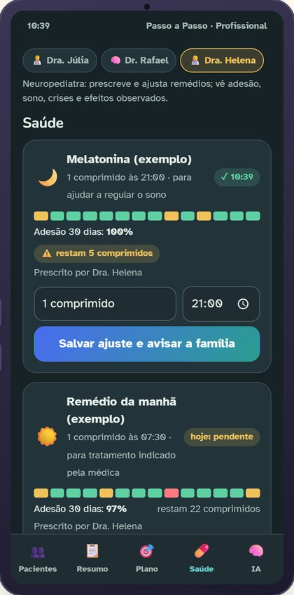
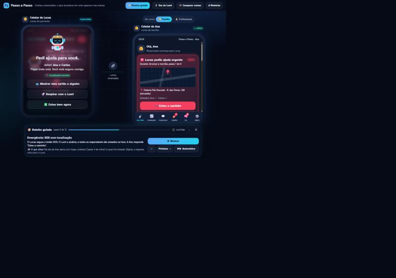

# 👣 Passo a Passo · Lumi

**Uma IA que ensina a _não precisar dela_.** Apoio à autonomia de pessoas autistas, com um robô companheiro (o **Lumi**) que enxerga a situação pelo celular, fala no jeito de cada pessoa e, a cada conquista, ajuda um pouco menos. A família e os profissionais acompanham por contas conectadas.

> Projeto do **NAUFest #AIforImpact2026**. É um **protótipo funcional com dados fictícios**, não um produto clínico. Aberto no navegador, sem instalar nada e sem servidor.

| | |
|---|---|
| 🧭 **Teste em 3 minutos** | abra `app.html?roteiro=1` (veja [como publicar](#como-rodar-e-publicar)) e toque em **▶▶ Automático** |
| 📖 **Guia dos jurados** | [`docs/GUIA-DOS-JURADOS.md`](docs/GUIA-DOS-JURADOS.md) |
| 📝 **Proposta (etapas do NAUFest)** | [`docs/PROPOSTA.md`](docs/PROPOSTA.md) |
| 🏗️ **Arquitetura** | [`docs/ARQUITETURA.md`](docs/ARQUITETURA.md) |
| 🛠️ **Como foi construído** | [`docs/PROCESSO.md`](docs/PROCESSO.md) |

## O problema

O treino terapêutico acontece em poucas horas por semana, no consultório. A dificuldade, o risco e a sobrecarga sensorial acontecem nas outras. E quem cobre essa lacuna, quase sempre, é uma mãe sem apoio.

- **2,4 milhões** de pessoas com diagnóstico de autismo no Brasil (IBGE, Censo 2022). [[1]](docs/FONTES.md)
- **56,5%** recebem até 2 horas de terapia por semana; **92,4%** de quem cuida são mulheres; **30,5%** dos cuidadores estão sem renda própria. [[5]](docs/FONTES.md) (pesquisa voluntária, não representativa)
- Filas de terapia de cerca de **3 anos** em Campo Grande (MS). [[6]](docs/FONTES.md)

Todas as fontes, com as ressalvas de cada número, estão em [`docs/FONTES.md`](docs/FONTES.md).

## A solução

1. **Antes:** a IA conta a tarefa em uma **história social** com figuras e voz.
2. **Durante:** o Lumi guia pela voz e pela câmera, **diminuindo a ajuda** conforme a pessoa aprende (instrução → pergunta → silêncio atento). Há botão de calma e **SOS** com localização.
3. **Depois:** a IA registra cada passo, mostra a evolução de **meses** e sugere a próxima fase, **mas só um humano aprova**.

Por que IA e não um app de lembretes: ela **enxerga** a cena e confirma os passos, **adapta a linguagem** ao nível e ao hiperfoco, **dosa a ajuda** no tempo certo, **pergunta** à família e aos profissionais, **lê laudos** para ajustar o app e organiza os dados de saúde para a consulta.

## Telas

| Paciente: início | Modo guia (fase 2) | Conversa por figuras (CAA) | Lembrete de remédio |
|---|---|---|---|
|  |  |  |  |

| Família: SOS | Família: evolução | Família: IA lê o laudo | Profissional: plano | Médica: remédios |
|---|---|---|---|---|
|  |  |  |  |  |

No computador, o app mostra os aparelhos **em tamanho real, escalados por inteiro**: o celular do Lucas, o **relógio do Carlos** (pai) e o celular da Ana (ou o tablet do profissional). Em telas largas o **roteiro guiado** fica numa coluna à direita. (Captura abaixo da versão anterior, com o tema escuro.)



## O que tem hoje

**Paciente (Lucas)**
- Lumi: robô que muda de humor e **evolui** com a autonomia (cachecol, fones, capacete, visual do hiperfoco, capa).
- Agenda visual, check-in de humor, **história social** antes da tarefa.
- **Modo guia** com desvanecimento de dicas; câmera com **reconhecimento de objetos e direção** ("a mochila está à sua esquerda"); **decisão com duas opções**; sensor de ruído; botão de calma.
- **CAA**: monta frases com figuras (a IA as transforma em frase natural e sugere a próxima figura), mensagens com a família, **combinados** "primeiro → depois" e pedidos para **marcar** compromissos.
- **SOS** (segurar 1,5 s), cartão de ajuda, **lembrete de remédio** em figuras e "Meu jeito" (volume, voz, tela calma, letra maior).

**Família (Ana)**
- **Ao vivo** (passo atual e nível de ajuda do Lumi), alerta de emergência com mapa, avisos antecipados.
- **Evolução** de 14 meses com recuos (férias, mudança de escola) e sugestão de fase com aprovação.
- **Conversa** (figuras ⇄ texto), **Saúde** (remédios, adesão, estoque, diário de sono e crises, padrões percebidos pela IA, **conversa com a IA** sobre o tratamento, resumo para a consulta), **IA** (perguntas, laudo em PDF/TXT, aprendizados), **Mais** (voz, rotinas, contas e permissões).

**Profissionais**
- Dra. Júlia (terapeuta): plano terapêutico e metas medidas pelos dados. Dr. Rafael (neuropsicólogo): laudos. Dra. Helena (médica): **a única** que altera dose e horário. Botão **"Comparar contas"** mostra o que cada conta vê e faz.

**Relógio (Carlos, pai)**
- Só o essencial no pulso: **SOS** com botão "Estou indo", rotina **ao vivo** em anel de progresso, remédio, conquistas e mensagens do Lucas.

**Página inicial:** curta e infantil, com uma **sala de estar em 3D** (three.js) cheia de brinquedos: a Ana no sofá com o celular, o Carlos olhando o relógio e o Lucas brincando com o Lumi. Cada capítulo leva a câmera a uma parte da sala. Os detalhes (dados, critérios, cuidados, ética, roadmap, estudos do TCC e fontes) estão em `saiba-mais.html`.

**Design calmo e gamificado:** baseado nos estudos do TCC ([`docs/FONTES.md`](docs/FONTES.md#estudos-do-tcc-base-do-design)): uma coisa por tela, cores pastel, nada piscando e uma **trilha de estrelas** em cada rotina, sem placar e sem perder pontos.

**Voz humana:** o app toca falas gravadas e usa a voz sintética só onde falta. Na voz sintética, prefere vozes neurais (Microsoft Edge: Francisca, Thalita) e **não usa as vozes do Google**, que soam robóticas. O **estúdio** grava, importa e exporta as 218 falas ([`docs/FALAS-LUMI.md`](docs/FALAS-LUMI.md)).

## Real × simulado

| Funciona de verdade | É simulado |
|---|---|
| Visão computacional no aparelho (TensorFlow.js), voz, comandos de voz, medidor de ruído | Pessoas, remédios, histórico de 14 meses e laudo de exemplo (**fictícios**) |
| Desvanecimento de dicas e sugestão de fase com aprovação humana | Conversa entre **aparelhos diferentes** (aqui, as contas se falam no mesmo navegador) |
| Leitura de laudos em PDF e TXT, perguntas da IA e ajustes aprovados | Linguagem e respostas da IA por **regras** (no produto, um modelo de linguagem) |
| CAA, combinados, agenda, SOS, lembrete de remédio, permissões por conta | Respostas dos profissionais; PDF escaneado (sem OCR); relógio, colar e robô físico |

## Como rodar e publicar

Não há build nem dependência para instalar. Qualquer servidor estático serve (a câmera exige `https` ou `localhost`):

```bash
python -m http.server 8765
# abra http://localhost:8765  (site)  ou  http://localhost:8765/app.html?roteiro=1  (app com roteiro)
```

**Publicar no Firebase Hosting:** o `firebase.json` já está pronto; veja [`docs/FIREBASE.md`](docs/FIREBASE.md) (`firebase deploy --only hosting`).

**Publicar no GitHub Pages:** *Settings → Pages → Build and deployment → Deploy from a branch → `main` / `(root)` → Save*. A demo fica em `https://<usuário>.github.io/<repositório>/`. O arquivo `.nojekyll` já está na raiz.

## Testes

```bash
python -m http.server 8765
# abra http://localhost:8765/tests/fumaca.html
```

O **teste de fumaça** abre o app num iframe e executa 54 verificações: telas das três contas, SOS, relógio, CAA, remédio, laudo (texto e PDF, este precisa de internet para o `pdf.js`), permissões, inventário de falas e o roteiro guiado completo em modo acelerado. Não usa câmera nem microfone.

## Estrutura

```
index.html                   página inicial com a sala 3D
saiba-mais.html              detalhes, estudos do TCC e fontes
app.html                     o app (celular, relógio, celular/tablet)
firebase.json                publicação no Firebase Hosting
css/                         inicio.css, site.css, app.css
js/                          lumi, dados, nucleo, paciente, responsavel, conhecimento,
                             caa, saude, profissional, voz, relogio, roteiro, iniciar · sala3d (página inicial)
audio/lumi/                  falas gravadas publicadas (falas.json)
exemplos/                    laudo FICTÍCIO em PDF
tests/                       teste de fumaça
docs/                        proposta, arquitetura, processo, fontes, ética, roadmap, guias
```

## Documentação

| Documento | Para quê |
|---|---|
| [`docs/GUIA-DOS-JURADOS.md`](docs/GUIA-DOS-JURADOS.md) | Teste em 3 minutos, o que olhar, perguntas frequentes |
| [`docs/PROPOSTA.md`](docs/PROPOSTA.md) | A proposta nas etapas do NAUFest e a ligação com os critérios |
| [`docs/ARQUITETURA.md`](docs/ARQUITETURA.md) | Como o código funciona e como estender |
| [`docs/PROCESSO.md`](docs/PROCESSO.md) | Como o projeto foi construído, decisões, lições e o que falta |
| [`docs/FONTES.md`](docs/FONTES.md) | Fontes dos números, com ressalvas |
| [`docs/ETICA-E-PRIVACIDADE.md`](docs/ETICA-E-PRIVACIDADE.md) | Princípios, riscos e como são tratados |
| [`docs/ROADMAP.md`](docs/ROADMAP.md) | Próximas fases, métricas de impacto e vestíveis |
| [`docs/ROTEIRO-VIDEO.md`](docs/ROTEIRO-VIDEO.md) | Roteiro do vídeo de 3 minutos |
| [`docs/FALAS-LUMI.md`](docs/FALAS-LUMI.md) | As 218 falas para gravar com voz humana |
| [`docs/FIREBASE.md`](docs/FIREBASE.md) | Publicar no Firebase Hosting e o caminho para contas em aparelhos diferentes |

## Como foi feito

Idealizado e dirigido por uma pessoa, com apoio de uma IA de programação (Claude Code) para criticar a ideia, pesquisar fontes, programar, testar e documentar. O percurso completo, com decisões e problemas resolvidos, está em [`docs/PROCESSO.md`](docs/PROCESSO.md).

## Limitações e próximos passos

- **Não foi testado com pessoas autistas, famílias ou profissionais.** Esse é o primeiro passo do roadmap, junto com um piloto responsável (comitê de ética, consentimento, acompanhamento clínico).
- Câmera, microfone e localização reais precisam ser conferidos em celulares (Android e iPhone); o ambiente de desenvolvimento os bloqueia.
- A troca entre aparelhos diferentes exige um servidor seguro; modelos de linguagem entram no piloto, com dados mínimos.
- Software que apoia decisões de saúde pode exigir avaliação regulatória: veja [`docs/ETICA-E-PRIVACIDADE.md`](docs/ETICA-E-PRIVACIDADE.md).

## Licença e dados

Os dados de paciente, família, profissionais, remédios, histórico e laudo são **fictícios**. Ainda não há arquivo de licença: sem ele, todos os direitos permanecem com a autora ou o autor. Para permitir o uso por terceiros, acrescente um `LICENSE` (por exemplo, MIT para o código e CC BY para a documentação).
